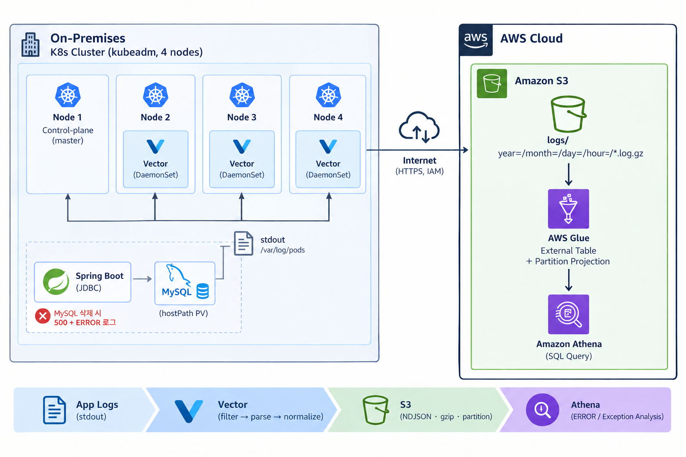

# vector-s3-log-pipeline

온프레미스 Kubernetes 파드 로그를 **Vector**로 수집·파싱해 **AWS S3**에 적재하고, **Athena**로 장애를 분석·조치·검증하는 로그 기반 장애대응 파이프라인입니다.
기존 포트폴리오가 온프레미스에 편중되어 AWS 실전 경험을 보강하려고 시작했고, 단순 적재가 아니라 장애 재현 → 분석 → 조치 → 검증까지 한 루프로 완성하는 것을 목표로 했습니다.

- 기간: 2026.09.06 ~ 2026.09.11 · 개인 프로젝트 · AWS 리소스는 `terraform destroy`로 정리 완료

## 아키텍처



※ 그림의 'MySQL 삭제'는 실제로는 kubectl scale --replicas=0으로 재현

## 구성과 기술 선택 이유

| 영역 | 선택 | 이유 |
|---|---|---|
| 수집 | Vector 0.41.1 DaemonSet (worker 3노드에 각 1개) | `source → transform → sink` 구조. allowlist, 예외 스택트레이스 멀티라인 병합, 이벤트시각 기준 파티션 |
| 저장 | S3 (NDJSON, gzip, `year=/month=/day=/hour=` 파티션) | 계속 쌓이는 로그에 적합, 파티션으로 스캔 범위 축소 가능 |
| 분석 | Athena + Glue 테이블(파티션 프로젝션) | 상시 서버 없이 SQL 애드혹 분석, MSCK REPAIR 불필요 |
| 인증·보안 | Vector 전용 IAM 사용자(PutObject만) + 버킷 TLS 강제·퍼블릭 차단 + SSE-S3 | 온프레미스라 IRSA 불가. 키가 유출돼도 이 버킷에 쓰기만 가능 |
| IaC | Terraform (S3·IAM·Glue·Athena workgroup) | 손으로 만든 리소스 0개 → `terraform destroy` 한 번으로 정리 |
| 소스 앱 | Spring Boot + MySQL 8.0 (hostPath PV) | "DB 장애 → 앱 5xx → 로그로 원인 추적" 시나리오용 최소 앱 |

분석 결과: MySQL을 `replicas=0`으로 중지해 재현한 장애를 Athena 쿼리로 예외 유형·시각·파드까지 로그만으로 특정했고, MySQL 복구 후 ERROR 5 → 0 (앱 재기동 후 측정).

## 대표 장애 사례: S3 출력이 JSON 배열로 저장돼 Athena가 못 읽음

- **증상**: S3 적재는 되는데, Athena에서 조회하면 첫 행에 JSON 전체가 뭉쳐 들어가는 등 파싱이 깨짐
- **원인**: Vector `aws_s3` sink의 기본 framing이 이벤트를 `[{...},{...}]` 형태의 JSON 배열로 묶어 저장. Athena의 JsonSerDe는 한 줄에 JSON 하나(NDJSON)를 기대함
- **조치**: sink에 `framing.method: newline_delimited`를 추가해 NDJSON으로 전환 → Athena가 각 로그를 행으로 읽음
- **재발 방지**: 적재 직후 행 수 확인은 다음 단계

## 한계와 다음 단계

- S3 전송 실패는 디스크 버퍼 삭제 후 해소됐지만 원인은 확정하지 못함. 가설 두 가지: ① 버퍼에 남은 상태가 재시도에 영향 ② PutObject만 허용한 정책 때문에 HeadBucket 헬스체크가 403('Invalid credentials')
- NDJSON 전환 전에 적재된 파일의 재적재 방법은 기록 없음
- 3주 방치로 약 3,000원 청구(예상 200원 이내) → 현재 destroy 완료. AWS Budgets 알림, S3 수명주기 규칙은 다음 단계
- 장기 액세스 키 제거(IAM Roles Anywhere), Secret 관리 개선, MySQL 백업(미수행)은 다음 단계
- 실습 환경 한정: MySQL 비밀번호가 Secret manifest와 `application.yml`에 평문

## 실행 방법 (레포 파일 기준으로 정리, 실행 검증 안 함)

```bash
# 1. AWS 리소스 생성 (S3, IAM, Glue, Athena workgroup)
cd terraform
terraform init
terraform plan
terraform apply

# 2. Vector용 액세스 키를 K8s Secret으로 주입 (daemonset.yaml이 vector-aws-creds Secret을 참조)
kubectl apply -f ../k8s/infra/00-namespace.yaml
kubectl -n log-pipeline create secret generic vector-aws-creds \
  --from-literal=AWS_ACCESS_KEY_ID="$(terraform output -raw vector_access_key_id)" \
  --from-literal=AWS_SECRET_ACCESS_KEY="$(terraform output -raw vector_secret_access_key)"

# 3. MySQL, Spring 앱, Vector 배포
cd ..
kubectl apply -f k8s/infra/mysql/
kubectl apply -f k8s/apps/spring/
kubectl apply -f k8s/apps/vector/

# 4. 장애 재현
kubectl -n log-pipeline scale deploy mysql --replicas=0

# 5. 정리
cd terraform && terraform destroy
```

### 디렉터리 구조

```
vector-s3-log-pipeline/
├── terraform/              # AWS 인프라 (s3.tf, iam.tf, athena.tf, outputs.tf)
├── app/                    # DB 의존형 Spring Boot 앱 (/items, /health)
├── k8s/
│   ├── infra/              # 네임스페이스, MySQL(hostPath PV/PVC)
│   └── apps/
│       ├── spring/         # Spring 앱 배포
│       └── vector/         # Vector RBAC, ConfigMap(파이프라인), DaemonSet
└── .github/workflows/      # Spring 앱 빌드 → DockerHub
```

---

상세 내용: [노션 포트폴리오](https://app.notion.com/p/3efe08b1109d8101a034f938380b21dd)
